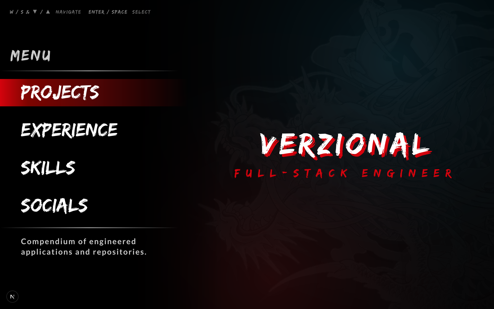

# Verzional's Portfolio

  

An interactive, high-fidelity portfolio website engineered with a **Yakuza & Persona-inspired video game HUD** aesthetic. Designed from the ground up around arcade-style tactile responsiveness, reactive visual feedback, and full keyboard navigation.

The application serves as both a software engineering showcase and an interactive playground—featuring a custom dynamic stance ability wheel, angular confidant timelines, and authentic game menu interfaces.

---

## Pages

- **[Projects](https://verzional.com/projects) (`/projects`)** — Compendium of engineered applications and repositories, rendered as an interactive Persona-style item catalog.
- **[Experience](https://verzional.com/experience) (`/experience`)** — Confidant network of professional roles and milestones, rendered as an interactive Persona-style tarot dossier.
- **[Skills](https://verzional.com/skills) (`/skills`)** — Ability wheel of core technologies and frameworks, rendered as an interactive Yakuza-style combat wheel.
- **[Socials](https://verzional.com/socials) (`/socials`)** — Map of digital profiles and networking channels, rendered as an interactive Kamurocho-style urban transit map.

---

## Tech Stack

| Layer | Technology | Description |
| :--- | :--- | :--- |
| **Framework** | Next.js 16 (Turbopack) | Modern React framework utilizing App Router, Server Components, and optimized asset delivery |
| **Compiler** | React 19 Compiler | React 19 architecture with automatic memoization and fine-grained reactivity |
| **Styling** | Tailwind CSS v4 | Cutting-edge v4 engine using native CSS theme variables and high-contrast dark mode palettes |
| **Animation** | Motion (`motion/react`) | Weighted video game physics transitions (`[0.33, 1, 0.68, 1]`), SVG pathlength routing, and spring dynamics |
| **Typography** | Edo SZ & Linux Biolinum | Custom display typography capturing brush-stroke calligraphy and classic serif styling |
| **Icons** | Lucide React | Clean, scalable vector iconography embedded throughout the HUD interfaces |
| **Analytics** | Vercel Analytics & Insights | Real-time Core Web Vitals tracking and privacy-conscious audience telemetry |
